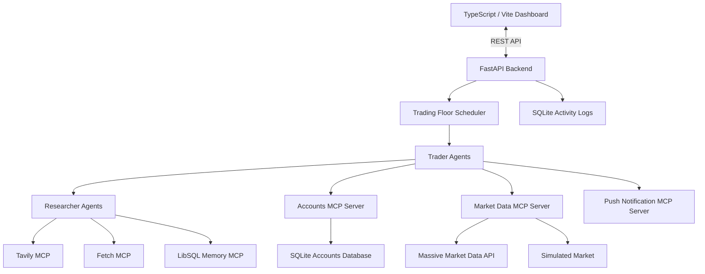

# Autonomous Trading Floor

**A Multi-Agent AI Trading Simulation powered by Python, OpenAI Agents SDK, MCP, FastAPI, and TypeScript.**

Autonomous Trading Floor is a multi-agent trading simulation where AI-powered traders interact with market data, research tools, portfolio-management services, and persistent memory to make trading decisions.

The project combines autonomous agents, Model Context Protocol (MCP) integrations, a REST API, and interactive dashboards to create an observable trading environment.

## Features

- **Multi-agent architecture:** Multiple autonomous trader agents with configurable model providers.
- **Research agents:** Dedicated researcher agents equipped with web search and web-fetching capabilities.
- **MCP integrations:** Modular tool servers for market data, accounts, research, memory, and notifications.
- **Market data:** Massive API integration with a simulated-market fallback.
- **Portfolio management:** Account management, holdings, transactions, and portfolio valuation.
- **Real-time monitoring:** Interactive trader dashboards with portfolio charts, heatmaps, activity logs, and transactions.
- **Scheduled execution:** Configurable trading and rebalancing intervals.
- **REST API:** FastAPI endpoints for accessing trader and market information.
- **Persistent storage:** SQLite-based account and activity-log storage.

## Architecture



### Agent workflow

1. The trading scheduler initiates an execution cycle.
2. Trader agents retrieve account information and trading strategies.
3. Researcher agents gather relevant information using web-search and fetching tools.
4. Trader agents use their available MCP tools to evaluate market conditions and make decisions.
5. Account and portfolio information is updated.
6. Activity logs and portfolio information are made available through the FastAPI backend.
7. The frontend periodically retrieves updated portfolio data and activity logs.

## Technology Stack

| Component | Technologies |
|---|---|
| Agent orchestration | OpenAI Agents SDK |
| Backend | Python, FastAPI, Uvicorn |
| Agent communication | Model Context Protocol (MCP) |
| Frontend | TypeScript, Vite, CSS |
| Charting | uPlot |
| Market data | Massive API |
| Research | Tavily MCP, Fetch MCP |
| Memory | LibSQL Memory MCP |
| Database | SQLite |
| Notifications | Pushover |
| Dependency management | uv |
| Frontend package management | npm |

## Project Structure

```text
autonomous-trading-floor/
├── backend/
│   ├── accounts.py
│   ├── accounts_client.py
│   ├── accounts_server.py
│   ├── api.py
│   ├── database.py
│   ├── market.py
│   ├── market_server.py
│   ├── market_simulator.py
│   ├── mcp_servers.py
│   ├── push_server.py
│   ├── reset.py
│   ├── templates.py
│   ├── tracers.py
│   ├── traders.py
│   └── trading_floor.py
├── demo/
│   ├── ui.py
│   └── util.py
├── frontend/
│   ├── src/
│   │   ├── api.ts
│   │   ├── chart.ts
│   │   ├── heatmap.ts
│   │   ├── log.ts
│   │   ├── main.ts
│   │   ├── panel.ts
│   │   ├── state.ts
│   │   ├── styles.css
│   │   ├── theme.ts
│   │   └── transactions.ts
│   ├── index.html
│   ├── package.json
│   └── vite.config.ts
├── 1_lab1.ipynb
├── 2_lab2.ipynb
├── 3_lab3.ipynb
├── 4_lab4.ipynb
├── 5_lab5.ipynb
├── app.py
├── .env.example
├── .gitignore
├── LICENSE
├── pyproject.toml
└── uv.lock
```

## Prerequisites

Install the following before running the application:

- Python 3.12 or newer
- [uv](https://docs.astral.sh/uv/)
- Node.js and npm
- Git

The application launches several MCP servers as subprocesses. The `uvx` command is provided by uv, while `npx` is provided by npm.

## Installation

### 1. Clone the repository

```bash
git clone https://github.com/dendzsubham-ctrl/autonomous-trading-floor.git
cd autonomous-trading-floor
```


### 2. Install Python dependencies

```bash
uv sync
```

This installs the dependencies defined in `pyproject.toml` and `uv.lock`.

### 3. Install frontend dependencies

```bash
cd frontend
npm ci
cd ..
```

### 4. Configure environment variables

Create your local environment file:

```bash
cp .env.example .env
```

On Windows PowerShell:

```powershell
Copy-Item .env.example .env
```

Configure the API keys you intend to use:

```dotenv
# Default OpenAI model provider
OPENAI_API_KEY=

# Alternative model providers
DEEPSEEK_API_KEY=
GOOGLE_API_KEY=
GROK_API_KEY=
OPENROUTER_API_KEY=

# Market data (optional)
MASSIVE_API_KEY=

# Research
TAVILY_API_KEY=

# Push notifications
PUSHOVER_USER=
PUSHOVER_TOKEN=

# Scheduler interval, in minutes
RUN_EVERY_N_MINUTES=60
```

Never commit your `.env` file or publish API credentials.

**Market data:** If `MASSIVE_API_KEY` is not configured, the application uses its simulated market-data implementation.

**Model providers:** Configure the credentials for the model provider selected by your trader configuration. The default OpenAI model requires `OPENAI_API_KEY`.

**Research and notifications:** Configure Tavily and Pushover credentials when using those integrations.

### 5. Prepare local memory storage

```bash
mkdir -p memory
```

The memory MCP server maintains separate LibSQL database files for individual traders.

## Running the Application

Run the following components in separate terminals from the project root.

### Terminal 1: FastAPI backend

```bash
uv run uvicorn backend.api:app --host 0.0.0.0 --port 8000
```

FastAPI will be available at:

- API: http://localhost:8000
- Interactive API documentation: http://localhost:8000/docs

### Terminal 2: Frontend dashboard

```bash
cd frontend
npm run dev -- --host 0.0.0.0 --port 5173
```

Open:

http://localhost:5173

The frontend communicates with the FastAPI backend through the Vite `/api` proxy.

### Terminal 3: Trading engine

From the project root:

```bash
uv run -m backend.trading_floor
```

The trading engine runs the configured scheduler and initiates agent execution cycles.

The default scheduler interval is 60 minutes. Change it through `RUN_EVERY_N_MINUTES` in `.env`.

### Optional: Gradio dashboard

The project also includes a Gradio interface:

```bash
uv run python app.py
```

This launches the alternative dashboard interface.

## API Reference

The FastAPI backend exposes the following endpoints:

| Method | Endpoint | Description |
|---|---|---|
| GET | `/api/traders` | Retrieve the list of traders |
| GET | `/api/market` | Retrieve market information |
| GET | `/api/traders/{name}` | Retrieve individual trader information |
| GET | `/api/traders/{name}/logs` | Retrieve recent trader activity logs |

Interactive API documentation is available at `/docs`.

## Frontend Dashboard

The TypeScript dashboard provides:

- Individual trader panels.
- Portfolio value and profit/loss monitoring.
- Portfolio charts.
- Market heatmaps.
- Recent activity logs.
- Transaction information.

The frontend polls portfolio data every 6 seconds and activity logs every 2 seconds.

## Building the Frontend

To create a production frontend build:

```bash
cd frontend
npm run build
```

The generated static files are placed in `frontend/dist/`.

## MCP Integrations

The application uses several MCP servers:

| MCP server | Responsibility |
|---|---|
| Accounts MCP | Account and strategy resources |
| Market MCP | Market information and price data |
| Massive MCP | External market-data integration |
| Tavily MCP | Web search |
| Fetch MCP | Web content retrieval |
| LibSQL Memory MCP | Trader-specific persistent memory |
| Push Notification MCP | Notifications through Pushover |

The Massive integration uses simulated market prices when the external market-data key is unavailable.

## Security

- API credentials are loaded through environment variables.
- Local environment files are excluded from version control.
- SQLite databases and persistent memory files are excluded from version control.
- Never publish API keys, private credentials, or personal account data.

## Project Background and Attribution

This project is based on the original MIT-licensed Agents repository by Ed Donner:

https://github.com/ed-donner/agents

The original project provided a foundation that has been customized and extended for the Autonomous Trading Floor application.

Original MIT copyright and licence terms are retained in the `LICENSE` file.

## Disclaimer

This project is an educational AI trading simulation.

It is not a brokerage platform, does not guarantee trading performance, and should not be interpreted as financial or investment advice. Market simulations and AI-generated decisions may be inaccurate. Use appropriate safeguards before connecting external market-data or trading services.

---

**Built as a multi-agent AI engineering project.**
